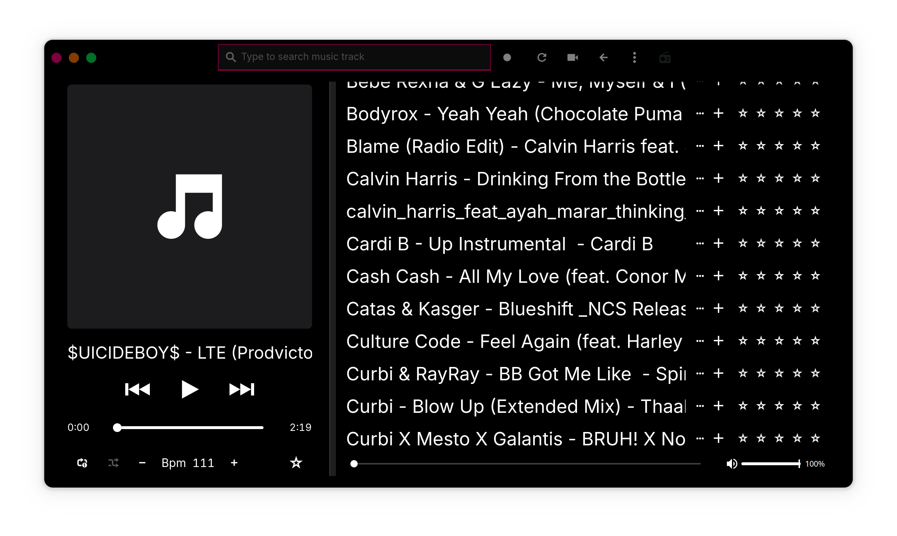
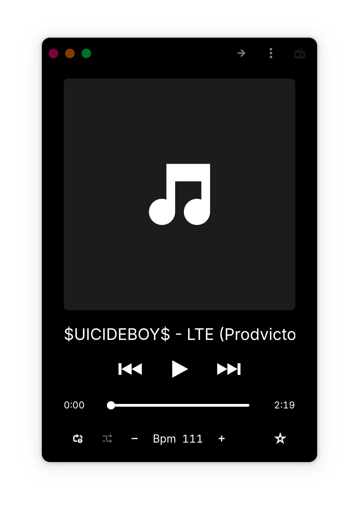
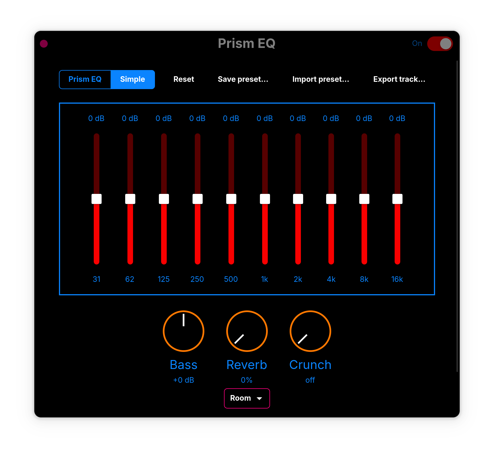
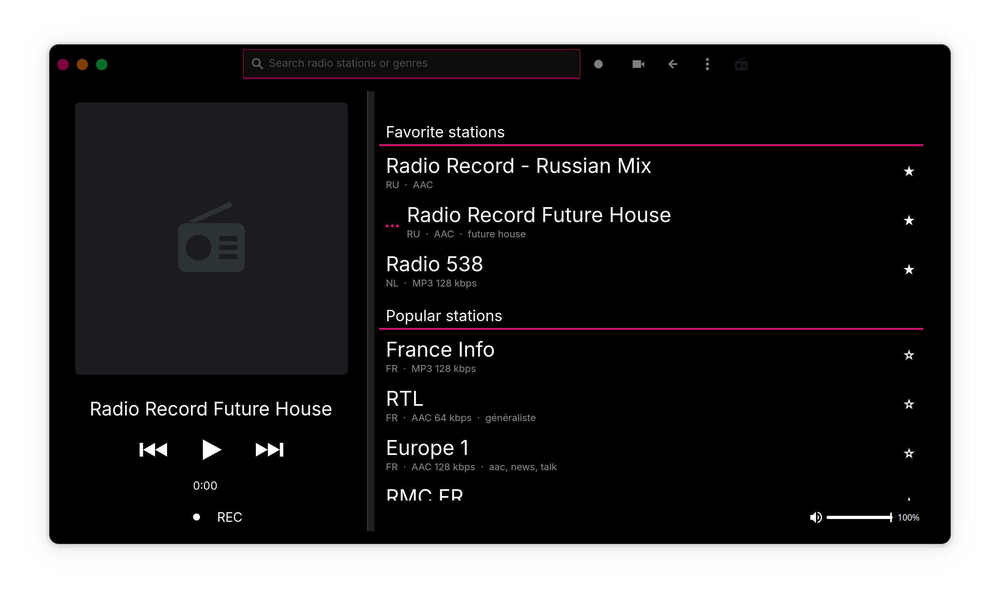
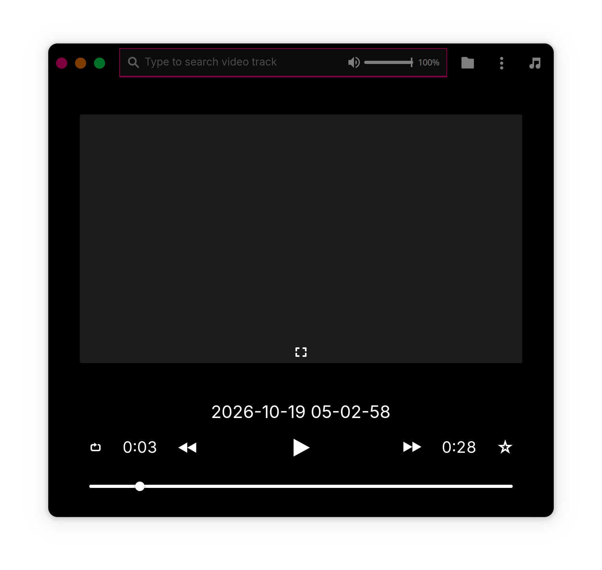

# Player-17

Music and video player for Linux with its own effects (Prism EQ, OTT, limiter), VST3, internet radio and a built-in browser.

Player-17 is made to sound good and stay easy to use.

- Plays MP3, FLAC, ALAC/M4A, OGG, Opus, WAV and more; videos in their own window
- **Plugins 17** — the player's own effects: Prism EQ (parametric, with a live spectrum, or Simple),
  saturator, OTT and limiter, in any order
- VST3 effects with their own windows and presets
- BPM detection, tempo change with Master Tempo, a saved tempo per track
- Internet radio with recording (FLAC)
- A built-in browser (Electron) with the same sound chain and Shield 17 against ads and trackers
- Export a track or a video with all effects applied
- Your own colors and transparency for the whole interface

| Compact | Prism EQ | Radio | Video |
|---|---|---|---|
|  |  |  |  |

## Install

Download the package for your system from **[Releases](https://github.com/sfh17/player-17/releases)**
(on the right of this page). Open the folder with the file (usually Downloads), right-click on an
empty space, choose "Open in Terminal" and copy the command. Close Player-17 before reinstalling
or removing it.

**Flatpak — any distro**

    flatpak install --user ./player-17_*_x86_64.flatpak       # install / update
    flatpak uninstall --user io.github.sfh17.Player-17         # remove

**Ubuntu / Zorin / Debian (.deb)**

    sudo apt install ./player-17_*_amd64.deb                  # install
    sudo apt install --reinstall ./player-17_*_amd64.deb      # reinstall / update
    sudo apt remove player-17                                 # remove

**Fedora (.rpm)**

    sudo dnf install ./player-17-*.rpm                        # install
    sudo dnf reinstall ./player-17-*.rpm                      # reinstall
    sudo dnf remove player-17                                 # remove

**Arch / Manjaro**

    sudo pacman -U ./player-17-*.pkg.tar.zst                  # install / update
    sudo pacman -R player-17                                  # remove

## Build from source

    sh packaging/deb/build-deb.sh                             # .deb, .rpm and Arch package
    flatpak-builder --user --install build packaging/flatpak/io.github.sfh17.Player-17.yml

## Feedback

Found a bug or have an idea? Open an [issue](https://github.com/sfh17/player-17/issues).

## License

Open source, [GPL-3.0](LICENSE). Made by sfh17.
